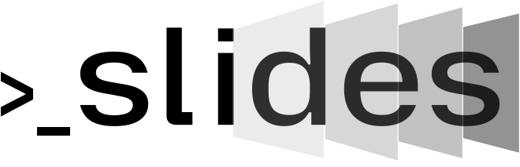

<h1 align="center">
  <picture>
    <source media="(prefers-color-scheme: dark)" srcset="assets/logo-dark.svg">
    
  </picture>
</h1>

<p align="center">
  <code>slides</code> reads, converts and dumps Keynote, PowerPoint and DeckWerk decks, from the command line or from Python.
</p>

<p align="center">
  
  
  
</p>

It reads all three formats into the same Python objects, so every command works the same way on each. You can use it to turn a deck into Markdown that an agent can read, to rebuild a DeckWerk deck as a native Keynote deck, or to give your plots a deck's colours and fonts. [DeckWerk](https://deckwerk.org) is a slide editor that saves each deck as a folder with a `deck.json` file in it.

## Install

```bash
uv tool install git+https://github.com/sahaslab/slides
```

The command installs `slides` in its own environment and puts it on your path. The commands that use Keynote also need macOS with Keynote installed, and they need your permission the first time (see [Keynote permissions](#keynote-permissions)).

## Common tasks

### Read a deck as text

```bash
slides dump talk.key -o talk.md
```

`dump` writes each slide's title, text, tables and presenter notes as Markdown. You can ask for JSON or plain text with `-f json` or `-f txt`, and you can keep only the presenter notes with `--notes-only`. If you leave out the file, `dump` reads the deck that's open in Keynote.

### Turn a DeckWerk deck into a Keynote deck

```bash
slides convert talk/ -f keynote
```

Keynote builds the deck itself, so you can open and edit the result like any other Keynote deck. The text keeps its fonts, colours, alignment and spacing, and the images keep their crops and masks. Shapes, videos, equations, builds and Magic Move transitions come across too. Use `-f pdf` to get a PDF instead. A 68-slide deck takes about a minute to convert.

### Match your plots to a deck

```bash
slides theme talk.key -f matplotlib > talk.mplstyle
```

`theme` finds the deck's background, text and accent colours, along with its fonts. It can write them as a matplotlib style sheet, a ggplot theme for R, CSS variables or JSON.

## Commands

The commands that read a deck take a Keynote file, a PowerPoint file or a DeckWerk folder, and they work out which one you gave them from the path.

| Command | What it does |
| --- | --- |
| `slides dump` | Writes a deck as Markdown, JSON or plain text. |
| `slides convert` | Converts a deck to Keynote, PDF, PowerPoint or DeckWerk. |
| `slides math` | Turns `$...$` LaTeX in a Keynote file into native Keynote equations. |
| `slides theme` | Writes a deck's colours and fonts as a theme for plots or web pages. |
| `slides info` | Lists a deck's slide count, size and assets. |
| `slides patch` | Writes titles, text, notes, images and tables into the open Keynote deck from a JSON file. |
| `slides scaffold` | Adds slides to a Keynote deck from a JSON file, optionally in a copy of a template. |

Run `slides <command> --help` to see each command's options. No command overwrites an existing file or changes the deck you give it, and only `patch` and `scaffold` change a deck that's open in Keynote.

## Use it from Python

Install `slides` into your own environment to import it. The `figures` extra adds matplotlib.

```bash
uv pip install "slides[figures] @ git+https://github.com/sahaslab/slides"
```

`read_deck` takes the same paths as the command line, and it returns a `Deck` object that holds the deck's slides, text, images and notes.

```python
from slides import read_deck
from slides.writers import markdown

deck = read_deck("talk.key")
print(markdown.render(deck, notes_only=True))
```

To style matplotlib figures with a deck's theme, pass the theme to `deck_style`.

```python
import matplotlib.pyplot as plt
from slides import read_deck
from slides.theme import extract
from slides.emit.matplotlib import deck_style

with deck_style(extract(read_deck("talk.key"))):
    fig, ax = plt.subplots()
```

## Requirements

### Keynote permissions

`slides` controls Keynote through Apple's scripting system, so macOS asks once whether your terminal app may control Keynote. If a command fails with error `-1743`, you either declined or macOS never asked. To fix it, open System Settings and go to Privacy & Security, then Automation. Find your terminal app in the list, and turn on Keynote under it. If your terminal app isn't in the list, the error message prints a `tccutil` command that makes macOS ask again.

The commands that use Keynote are `convert` to Keynote or PDF, `patch`, `scaffold`, and `dump` with no file.

### DeckWerk

Converting a deck to DeckWerk uses DeckWerk's own importer, so it needs a copy of the DeckWerk repository. `dump --via-deckwerk` uses the same importer. Set `SLIDES_DECKWERK_ROOT` to its folder, or pass `--deckwerk-root`. By default, `slides` looks in `~/src/deckwerk`.

## Development

```bash
conda create -n slides python=3.12
conda activate slides
pip install uv
cd path/to/slides
uv pip install -e . pytest
pytest
```

The tests use the small decks in `tests/fixtures`, and they never open Keynote. A few more tests need real decks, so they run only when you set `SLIDES_SAMPLE_DECKS` to a folder of them.
